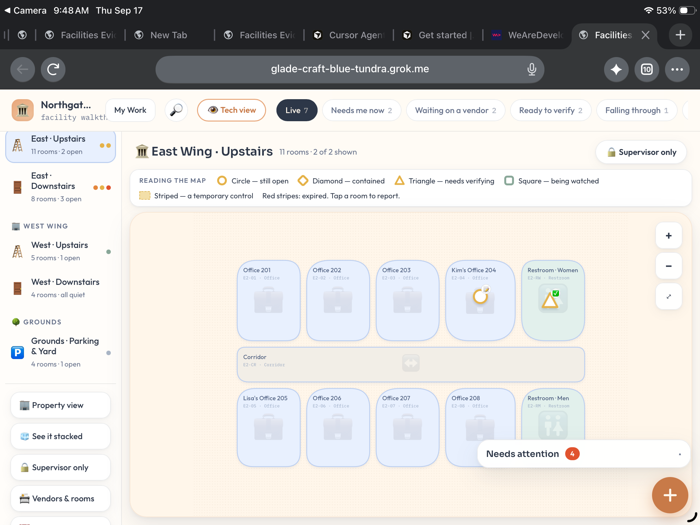
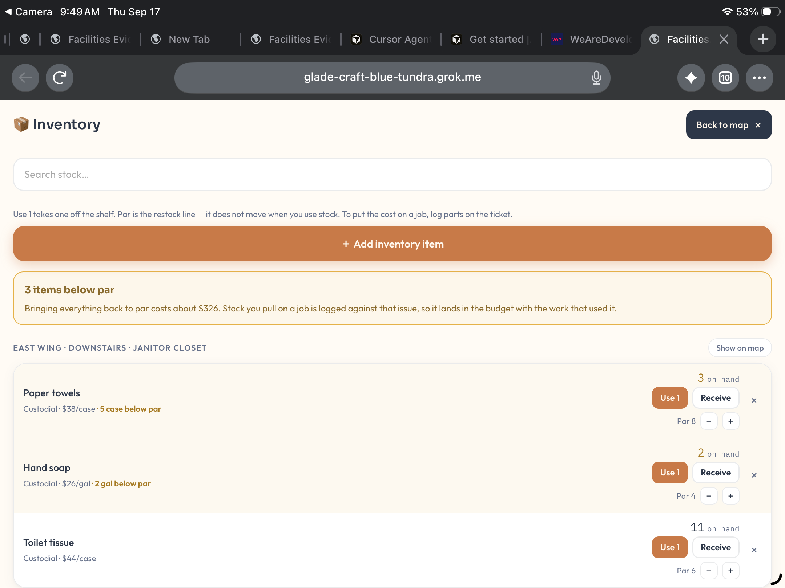
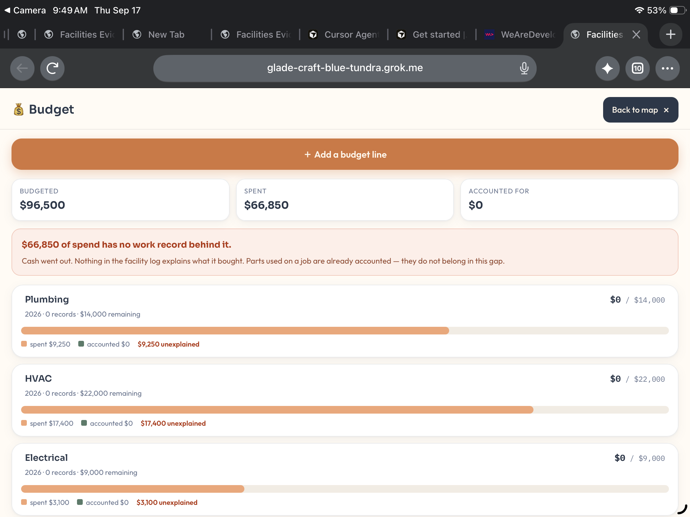

# Facilities Evidence OS (FEOS)

**Project creator and maintainer: [Tyler Katayama](https://github.com/tylerkat89)**

**Interact with your building, not your spreadsheets.**

**[Try the live site →](https://facilities-evidence-os.vercel.app)**

## What it does

FEOS is map-first facilities software. Issues, vendors, photo evidence, inventory, and budgets stay attached to the room they belong to, so maintenance teams enter information once and find it again from a floor plan.

- Floor-plan map as the home screen for a building
- Issue and work records tied to specific rooms
- Vendor and evidence capture without leaving the map context
- Inventory and budget views with role-based access for pilots
- QR landing pages so a phone can open the right room or record in the field

## Why

It comes from 10+ years of HVAC and facilities work: walking a property, finding the problem, and making sure the next person has the context. Spreadsheets and ticket lists lose the *where*; FEOS keeps it.

## Screenshots

| Inventory | Budget |
| --- | --- |
|  |  |

## Status

Active personal build and founding pilot. **Source is private; demo on request.**

## Contact

facilitiesevidenceos@gmail.com · [facilities-evidence-os.vercel.app](https://facilities-evidence-os.vercel.app)
